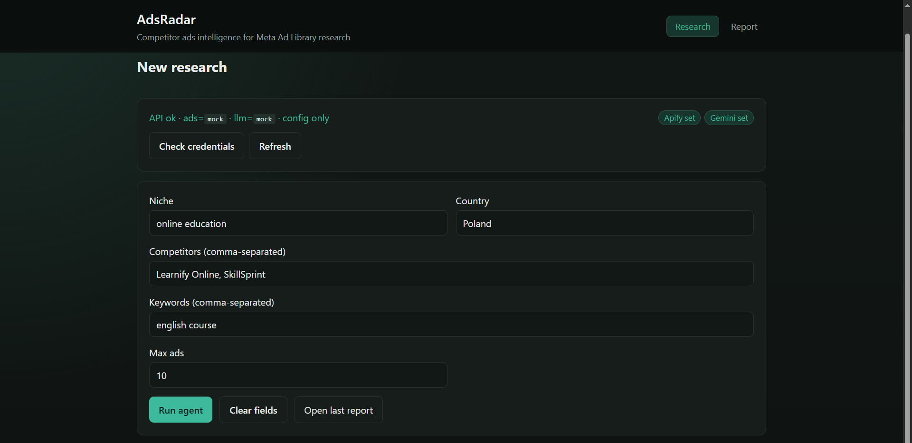
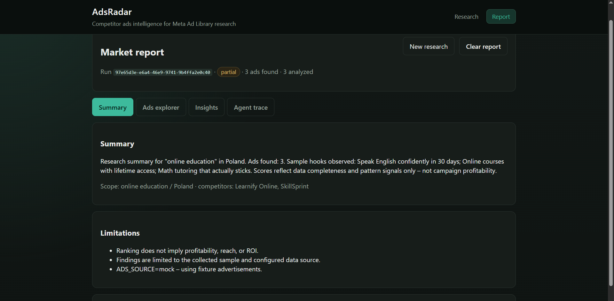
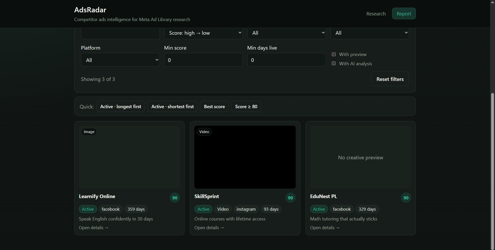
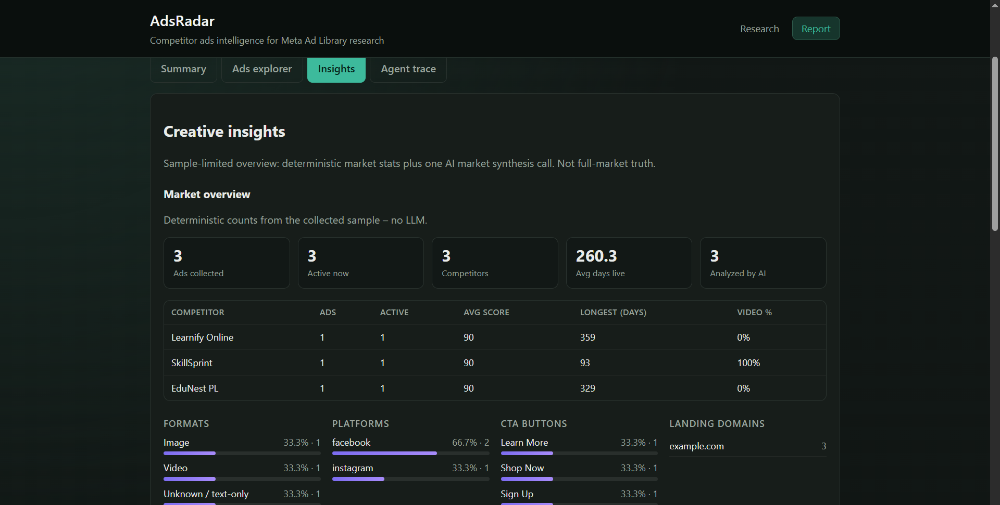
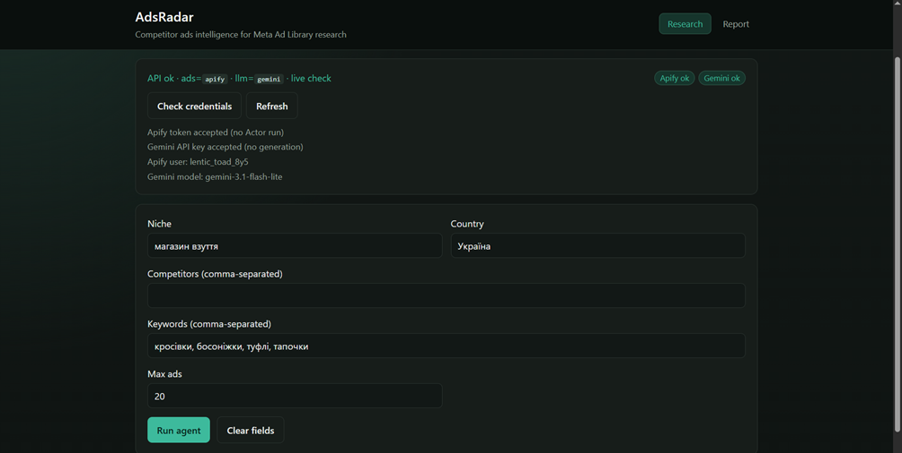
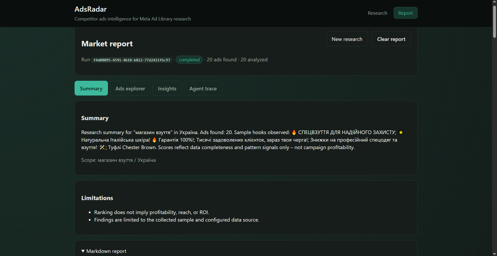
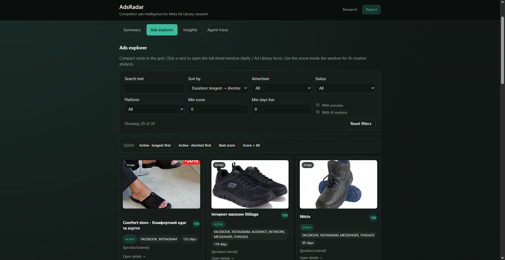
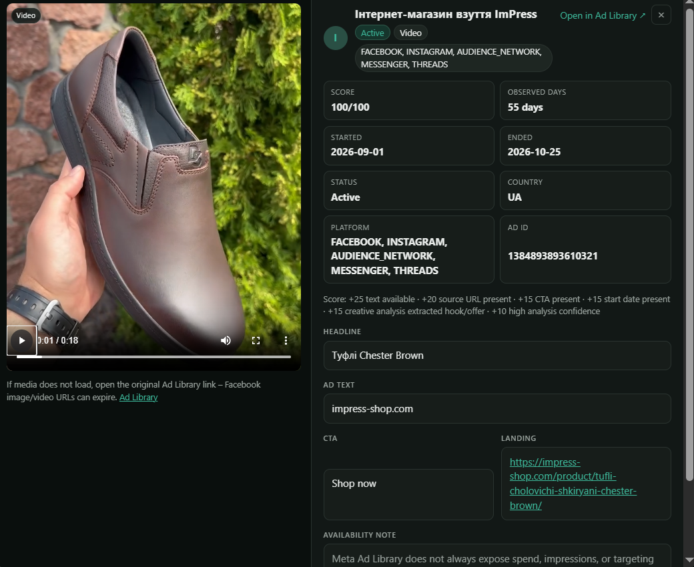
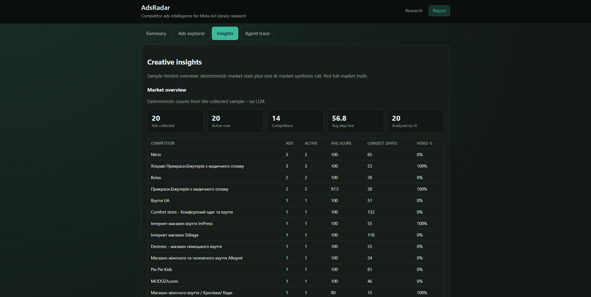
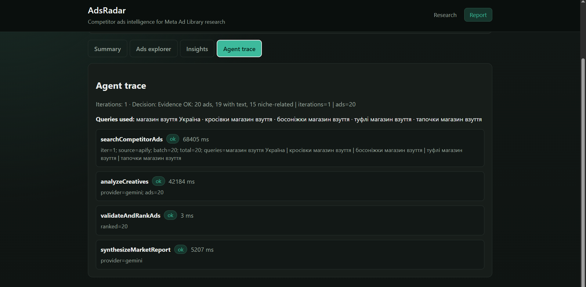

# AdsRadar (`ads-agent`)

Competitor ads intelligence **AI agent** for digital and affiliate marketers. It plans a research brief, searches public Meta Ad Library creatives (via Apify or local fixtures), optionally refines queries, analyzes creatives with an LLM, ranks evidence, and returns a structured JSON report plus a human-readable markdown summary – with market-level creative insights.

This repository is an **AI Developer test assignment** deliverable: a small, end-to-end agent workflow with tools, guardrails, observability, and tests.

---

## Problem statement

Media buyers and affiliate teams need to understand **what competitors are currently advertising** in a niche/geo: hooks, offers, CTAs, formats, and angles. Doing this manually in Meta Ad Library is slow and inconsistent.

AdsRadar automates a **research workflow**: given a niche, country, optional competitors/keywords, the agent collects a sample of public ads, extracts creative patterns, ranks completeness/signal quality (not ROI), and produces an analyst-ready report.

**Business value:** faster creative research, structured evidence for testing hypotheses, and a clear audit trail of what the agent did.

---


## What the agent does


### In scope

- Multi-step research: **plan → search → (optional refine) → analyze → validate/rank → market stats → market synthesis → report**
- Tools for search, creative analysis, ranking/validation, and market-report synthesis
- Structured **JSON** (`AgentOutput`) + **markdown** market report
- Mock modes for free local runs; live **Apify** + **Gemini** when credentials are set
- Guardrails: Zod validation, request timeout, prompt-injection refusal on user input, sanitization of untrusted ad text before LLM prompts, retries/fallbacks
- Observability: structured logs + `traceSummary` (tool calls, timings, decision)
- Web UI: research form, status bar, report tabs (Summary / Ads explorer / Creative insights / Agent trace)


### Out of scope (non-scope)

- Predicting spend, impressions, reach, conversions, or **ROI** (Meta does not expose these outside limited regions; we never invent them)
- Full-market coverage (results are **sample-limited** to collected ads)
- Multi-user auth, billing, or long-term run history database
- Automated media buying / campaign launch
- Scraping private or non-public ad data

---


## Business cases covered

1. **Niche creative scan** – “What hooks/offers appear in Meta ads for niche X in country Y?”
2. **Competitor watch** – focus queries on named advertisers / page targets
3. **Keyword expansion research** – seed keywords → agent may refine search when evidence is thin
4. **Creative briefing** – ranked ads + recurring hooks/CTAs/angles for copy/design teams
5. **Market-level insights** – deterministic format/platform/CTA stats + LLM market synthesis (gaps, recommendations, idea starters)

---


## Architecture overview


### Why a custom orchestrator (not LangGraph / Agents SDK)?

For this assignment size, a **custom planner/executor** keeps the control flow explicit, easy to test, and easy to audit:

- Deterministic steps and refine policy in TypeScript (not hidden in a graph DSL)
- Clear tool boundaries and Zod contracts at each stage
- Simple mock/live switching for Apify and Gemini without framework lock-in

Frameworks like LangGraph are excellent for larger stateful graphs; here the workflow is linear-with-refine and benefits more from readable code than from a heavy runtime.

### Components


| Layer                                          | Role                                                                                      |
| ---------------------------------------------- | ----------------------------------------------------------------------------------------- |
| **UI** (`client/`)                             | React + Vite – submit research, explore ads, insights, trace                              |
| **API** (`src/server.ts`, Express)             | `POST /api/research`, status/health                                                       |
| **Orchestrator** (`src/agent/orchestrator.ts`) | Multi-step agent loop + tool trace                                                        |
| **Planner / refine**                           | Builds queries; evaluates evidence; decides next queries                                  |
| **Tools**                                      | `searchCompetitorAds`, `analyzeCreatives`, `validateAndRankAds`, `synthesizeMarketReport` |
| **Integrations**                               | Apify Meta Ad Library scraper; Gemini (with model fallbacks)                              |
| **Schemas**                                    | Zod models for request, ads, analyses, insights, agent output                             |
| **Report**                                     | Markdown builder from structured output                                                   |


### Data flow

```text
ResearchRequest (niche, country, competitors, keywords, maxAds)
        │
        ▼
   Planner → searchQueries
        │
        ▼
┌───────────────────────┐
│ Search loop (≤ N)     │  searchCompetitorAds (mock | Apify)
│ evaluateEvidence      │
│ decideRefine?         │──► next queries / stop
└───────────────────────┘
        │
        ▼
 analyzeCreatives (mock | Gemini)  → per-ad hooks/offers/CTAs
        │
        ▼
 validateAndRankAds                 → scores + explanations (deterministic)
        │
        ▼
 buildMarketStats (deterministic) + synthesizeMarketReport (LLM)
        │
        ▼
 AgentOutput (JSON) + markdownReport
        │
        ▼
 UI report / sessionStorage (last run)
```


### Tools (4)

1. `searchCompetitorAds` – collect normalized public ads (fixture or Apify)
2. `analyzeCreatives` – LLM structured extraction per ad
3. `validateAndRankAds` – dedupe, score by evidence completeness / signals
4. `synthesizeMarketReport` – one market-level narrative synthesis call

---


## Stack


| Layer      | Choice                                                     |
| ---------- | ---------------------------------------------------------- |
| Backend    | Node.js 20+, TypeScript, Express                           |
| Agent      | Custom orchestrator + tools                                |
| Validation | Zod                                                        |
| Ads data   | Apify `facebook-ads-scraper` + mock fixtures               |
| LLM        | Google Gemini (`gemini-3.1-flash-lite` + fallbacks) + mock |
| Frontend   | React + Vite                                               |
| Tests      | Vitest                                                     |
| Container  | Docker Compose (API)                                       |


---


## Repository layout

```text
ads-agent/                 # repository / npm package name
├── src/                   # API + agent + tools + integrations
├── client/                # React UI (package: ads-agent-client)
├── tests/
│   ├── unit/
│   ├── integration/       # full mock workflow
│   └── fixtures/          # sample ads, output, trace
├── scripts/               # check:creds, smoke:apify, smoke:gemini
├── Dockerfile
├── docker-compose.yml
└── README.md
```

---


## Setup (local run)


### Prerequisites

- Node.js **≥ 20**
- npm
- (Optional) Docker Desktop – for API-only container run
- (Optional) Apify token + Gemini API key – for live modes


### Install

```bash
cp .env.example .env
npm install
npm install --prefix client
```

Recommended for first run / reviewers (**no paid quota**):

```env
ADS_SOURCE=mock
LLM_PROVIDER=mock
```


### Run API + UI

```bash
# terminal 1 – API http://localhost:3000
npm run dev

# terminal 2 – UI http://localhost:5173
npm run dev:client
```

Health: `GET http://localhost:3000/health`

UI talks to the API at `http://localhost:3000` by default (`VITE_API_BASE`). Ensure `CORS_ORIGIN` includes `http://localhost:5173`.

### Live providers (optional)


| Mode     | Env                                      | Notes                                |
| -------- | ---------------------------------------- | ------------------------------------ |
| Live ads | `ADS_SOURCE=apify` + `APIFY_TOKEN`       | Uses Apify Actor (costs quota)       |
| Live LLM | `LLM_PROVIDER=gemini` + `GEMINI_API_KEY` | Creative analysis + market synthesis |


Cheap credential ping (no Actor run, no `generateContent`):

```bash
npm run check:creds
```

Paid smokes (only when ready):

```bash
npm run smoke:apify
npm run smoke:gemini
```


### Docker (API)

With Docker Desktop running:

```bash
npm run docker:up
# or: docker compose up --build
```

API on `http://localhost:3000` with `ADS_SOURCE=mock` and `LLM_PROVIDER=mock`.  
Frontend is still run via Vite locally (`npm run dev:client`).

Stop: `npm run docker:down`

---


## How to test / verify


### Automated tests

```bash
npm test
```

- **Unit** (`tests/unit/`): sanitize, timeout, refine logic, Apify normalize, LLM parse, market stats, Gemini model chain, status, etc.
- **Integration** (`tests/integration/agent-workflow.test.ts`):
  - full mock path `executeResearch` → tools in trace, insights, markdown
  - progress stages
  - refine loop when first search returns too few ads

Watch mode: `npm run test:watch`  
Typecheck: `npm run typecheck`

### Manual scenarios

Checklist for a human reviewer (or you) after `npm run dev` + `npm run dev:client`.

1. **Mock end-to-end** — full UI path without Apify/Gemini spend
  - `.env`: `ADS_SOURCE=mock`, `LLM_PROVIDER=mock`  
  - Open [http://localhost:5173](http://localhost:5173) → enter niche/country → **Run agent**  
  - Expect `/report` with tabs: Summary, Ads explorer, Creative insights, Agent trace
2. **Status bar** — config visibility without burning quota
  - Shows current `ads` / `llm` modes  
  - **Check credentials** → `GET /api/status?live=1` (token/key ping only; no Actor run, no `generateContent`)
3. **API-only** — same research without the UI
  ```bash
   curl -X POST http://localhost:3000/api/research ^
     -H "Content-Type: application/json" ^
     -d "{\"niche\":\"online education\",\"country\":\"Poland\",\"competitors\":[\"Learnify Online\"],\"keywords\":[\"english course\"],\"maxAds\":10}"
  ```
   Expect JSON body with `result` (structured agent output) and `markdownReport` (human-readable text).
---


## Example inputs / outputs

Two worked examples: a **free mock run** (no Apify/Gemini quota) and a **live run** with connected providers.

---


### Example 1 — Mock scenario

**Env:** `ADS_SOURCE=mock`, `LLM_PROVIDER=mock`

#### Input

```json
{
  "niche": "online education",
  "country": "Poland",
  "competitors": ["Learnify Online", "SkillSprint"],
  "keywords": ["english course"],
  "maxAds": 10
}
```

**UI input screenshot** (Research form before / at Run agent):



#### Output

Committed reference files:

- [tests/fixtures/sample-run-output.json](tests/fixtures/sample-run-output.json) — abbreviated agent JSON  
- [tests/fixtures/sample-run-trace.json](tests/fixtures/sample-run-trace.json) — example tool-call trace  
- [tests/fixtures/ads.fixture.json](tests/fixtures/ads.fixture.json) — mock ads used when `ADS_SOURCE=mock`

Illustrative fields from a mock run:

```json
{
  "status": "partial",
  "adsFound": 3,
  "humanSummary": "Research summary for \"online education\" in Poland. Ads found: 3. …",
  "insights": {
    "recurringHooks": ["Speak English confidently in 30 days", "Online courses with lifetime access"],
    "recurringCtas": ["Learn More", "Shop Now", "Sign Up"]
  },
  "limitations": [
    "Ranking does not imply profitability, reach, or ROI.",
    "Findings are limited to the collected sample and configured data source."
  ]
}
```

`status: "partial"` is expected in mock mode (fixture ads + mock LLM, not a full live completion).

**UI output screenshots** (after redirect to `/report`):







---

### Example 2 — Live scenario (Apify + Gemini)

**Env:** `ADS_SOURCE=apify`, `LLM_PROVIDER=gemini` (credentials verified via Status bar → Check credentials)

#### Input

```json
{
  "niche": "магазин взуття",
  "country": "Україна",
  "competitors": [],
  "keywords": ["кросівки", "босоніжки", "туфлі", "тапочки"],
  "maxAds": 20
}
```

Providers at run time: Apify (`facebook-ads-scraper`) + Gemini (`gemini-3.1-flash-lite` with configured fallbacks).



#### Output

Live results include ranked ads from Meta Ad Library, `insights.marketStats` (deterministic), `insights.marketReport` (LLM synthesis), markdown report, and `traceSummary.toolCalls`.

**UI output screenshots** (Report after a successful live run):










---


## Guardrails & reliability

- **Zod** schemas for request and agent output  
- **Request timeout** (`AGENT_REQUEST_TIMEOUT_MS`) around the full research run  
- **Prompt-injection** patterns in user fields → refused  
- Ad creative text treated as **untrusted data** (delimited + sanitized before Gemini)  
- **Retries** on transient provider errors; Gemini **model fallback chain**  
- Ranking scores are **deterministic evidence scores**, not performance claims  
- Explicit `limitations` / `warnings` in every result

---


## Observability

- Pino structured logs (`runId`, tool timings, decisions)  
- `result.traceSummary`: iterations, each tool call (`ok` / `error` / `skipped`), final decision string  
- UI **Agent trace** tab mirrors the same summary

---


## Trade-offs, limitations, and next steps


### Trade-offs

- Custom orchestrator → clarity and testability vs. less “framework magic”  
- Stateless API + browser `sessionStorage` for last report → simple demo vs. no shared history  
- Mock-first → reliable CI/review vs. live Meta/Gemini variability


### Limitations

- Sample size capped (`maxAds` / Apify limits)  
- No spend/ROI; longevity heuristics are observational only  
- Market report quality depends on LLM + sample noise in Ad Library search  
- Docker image currently serves **API only** (UI via Vite)


### Next steps (production-minded)

- Persist runs (e.g. SQLite) and Apify result cache  
- Auth, per-tenant quotas, rate limits  
- Human-in-the-loop review before acting on recommendations  
- Stronger relevance filtering / language detection on scraped ads  
- Production static hosting for the client in Compose/K8s  
- Metrics/alerts on tool failure rates and latency

---


## Real-world usage

**Is this solution currently used in any business?**

**Not in production today.**  
This repository is a **test-assignment prototype**. It is not deployed for a paying customer, and this exact codebase runs in a live company.

That does **not** mean the *problem* is unique. Competitor creative research (Meta Ad Library reviews, hook/offer/CTA digests) is already done by agencies and some ad-intel products — often manually, with dashboards, or with emerging AI assistants. AdsRadar is an independent implementation of that workflow as a **tool-using agent** (plan → search → refine → analyze → rank → synthesize), built to demonstrate agent design for this assignment.

**Realistic teams that could use a productionized version of this approach:**

1. **Affiliate / media buying agencies** — weekly competitor creative digests per GEO/offer
2. **In-house performance marketing** — briefing designers/copywriters from live Ad Library samples
3. **MarTech / ad-intel product teams** — embedding a research agent inside a larger dashboard (history, alerts, multi-tenant workspaces)

**To productionize**, a team would typically can add:

- **Security** — secrets management, authentication/authorization, prompt-injection monitoring, no secrets in logs  
- **Monitoring** — traces/metrics for Apify/LLM cost, latency, and tool failure rates  
- **Data access** — compliant use of public Ad Library data; retention policies; run history DB + Apify cache  
- **Human-in-the-loop** — analyst review of insights before creative or budget decisions  
- **Compliance** — alignment with Meta/Apify terms of use; audit logs for regulated clients

---

